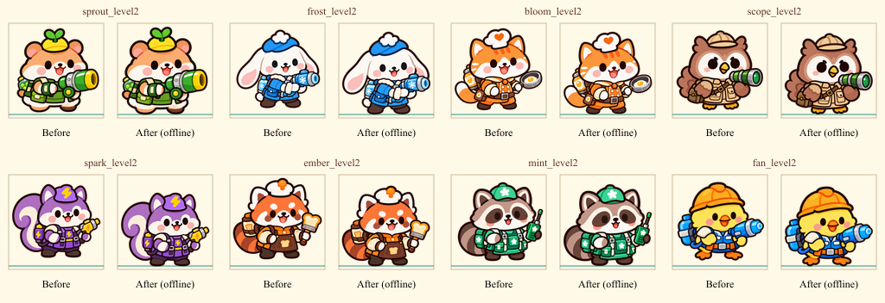

# UI还原方法调研与第一轮落地

日期：2026-10-23。版本：1.25.0。基线：1.24.1（bc9deab）。

本轮先验证图像适配方法，再推广到共用控件。**这是共享图片层与审阅流程的改进，不是全部界面完成1:1实屏验收的结论。** 用户已确定的首页、图鉴排版与交互继续作为约束。

## 检索与选择

|方案|原仓库与官方依据|本项目处理|
|---|---|---|
|Figma→Cocos分层导入|[lambertlbss/cocos](https://github.com/lambertlbss/cocos)，文档面向Creator 3.8.7，支持可编辑节点、PNG、字体映射和增量更新|现有材料主要是图片，没有对应分层源稿，不能直接反推正确层级。本轮未安装；以后有分层源稿时单独验证3.8.8兼容性。|
|图片／HTML智能导入|[wanghaisheng/cocos-creator-ui-ai-generation](https://github.com/wanghaisheng/cocos-creator-ui-ai-generation)|没有把宣传效果当作本项目可用性证明，不据此覆盖现有Prefab。|
|PNG测量、适配与合成|[Sharp](https://github.com/lovell/sharp)、[官方resize说明](https://sharp.pixelplumbing.com/api-resize/)|已采用作者工具做PNG接触表、等比适配与离线对照；游戏内仍用原生SpriteFrame。|
|像素差分|[Pixelmatch](https://github.com/mapbox/pixelmatch)|已实际接入本地PNG比较，输出差异图，不自动更新正确基线。|
|图片比较备选|[looks-same](https://github.com/gemini-testing/looks-same)|本轮Pixelmatch已经满足比较需要，不叠加依赖。|
|尺寸与九宫|[Cocos Sprite](https://docs.cocos.com/creator/3.8/manual/en/ui-system/components/editor/sprite.html)、[SpriteFrame导入](https://docs.cocos.com/creator/3.8/manual/en/asset/sprite-frame.html)|保留独立PNG、完整画布、原生SpriteFrame和九宫，不启用新图集，不重画美术。|

采用流程：确认参考图→明确槽位／图像／文字／状态层→测量可见区域→按用途适配→逐页实屏对照→保留基线。统一文件画布尺寸，不能消除不同留白造成的视觉偏差；换工具也不能补齐截图中没有的分层信息。

## 试点对比

同一套原PNG在110×110离线槽位中对比：左侧为现有画布适配，右侧为可见区域适配与落脚线。没有重新生图、裁掉武器或缩放父级布局。

|组别|改前底部位置范围|改后底部位置|
|---|---|---|
|8位一级店员|98.40～106.56|106.15|
|8位二级店员|96.68～103.55|106.15|
|16种进化|90.23～98.83|106.15|

这些是图像位置测量，不是还原度分数。已人工查看全部10张PNG接触表及店员／进化前后对照；它们只说明图像完整性和适配结果，不能替代引擎画面。

## 推广与保护

- 全312条资源绑定（305个独立PNG路径）记录contentX／contentY／contentWidth／contentHeight，覆盖角色、怪物、强化、商品、皮肤与地图。
- 93个可换图槽位使用独立ImageArtwork子节点。85个按用途使用content或feet；8个首页／圆形头像槽位保持canvas，不统一放大已确认的构图。
- 外层保留原位置、大小、缩放、锚点、点击和角色运动；图片层内部等比适配。外层Sprite禁画，图片先于携带物与状态显示，防止双画和遮挡。
- 图鉴、详情、建造／进化、出战准备、补给、商店角色及管理列表、科技图标共用该机制；37套Prefab全部检查结构、字体和原有布局保留。
- 其余九宫按钮、面板、装饰和文字保留当前设计。人物完整可见区域相同不代表头部大小也完全相同；圆形头像保持独立规则。
- 四原始XLSX（ArtFrame／VisualSkin／UiLayout／Global）先修改，再导出42CSV与版本清单；原PNG、原meta、字体、战斗及经营数值未改。

## 工具与验证

[使用说明](../tools/ui/visual/README.md)包含测量、完整审阅和像素比较命令。PNG变化后未更新边界会阻止构建；禁止图片重复绘制或盖住携带物／状态。反复换基础、二级、进化、商品及制服不会累积缩放；科技变灰与共享改色作用于实际图片层。差分工具实测同图0差异、单像素1差异、拒绝错尺寸且不改写参考图。

202项必要检查通过：图片槽位7、配置31、PNG资源12、图鉴15、商店交互21、排行榜7、战斗操作5、挑战30、科技12、经营58、像素比较4。严格TypeScript、42表过期检查及37Prefab／3025节点／476Label通过。图鉴和排行榜的旧测试改读当前30冒险／10挑战配置，未为通过测试修改产品数据。

全部原有节点的几何、文字样式、可见性及原有兄弟顺序，与bc9deab逐字段核对；42表旧字段与原PNG／meta／字体另行核对。Web Mobile日志Finished，Creator退出36既有诊断保留；1051文件和42CSV核对后更新同一试玩来源，旧包备份，15项HTTP加载资源与新包一致。试玩http://127.0.0.1:4344/?v=1.25.0，未读写用户存档。

## 明确遗留

先前浏览器URL安全策略阻止本地游戏自动访问，本轮未绕过；**没有新增真实引擎或手机截图，也没有完整实屏交互验收**。因此，图像适配已落地，整页字色、面板间距、滚动边缘、遮罩、长文案和真机清晰度仍需逐页实屏复核，不能以离线接触表或构建通过宣布全部1:1完成。

待验覆盖：加载各进度；首页与大额余额；冒险锁定／解锁／末页；挑战三页；两类出战准备人数；图鉴三页签／末行／已知未知详情／各形态；便利店及全部管理弹窗；科技两页和分支各购买状态；排行榜页签／空态；战斗HUD、建造、升级出售、进化、首领、暂停和胜负重试；补给长短描述、专属角色、刷新可用／耗尽；设置和GM开发／正式隔离。参考图沿用用户确认版本，不把当前截图自动设为新正确基线。

证据见[evidence/ui-fidelity-20261023](evidence/ui-fidelity-20261023/README.md)。分支codex/pc-a/ui-fidelity-pipeline，未自动合并共享main。
