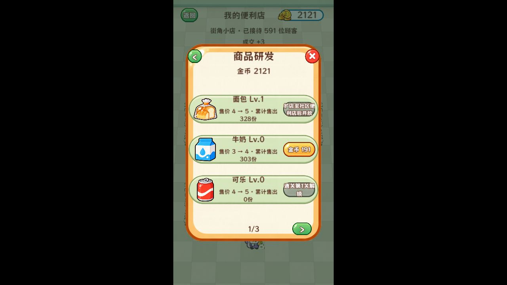
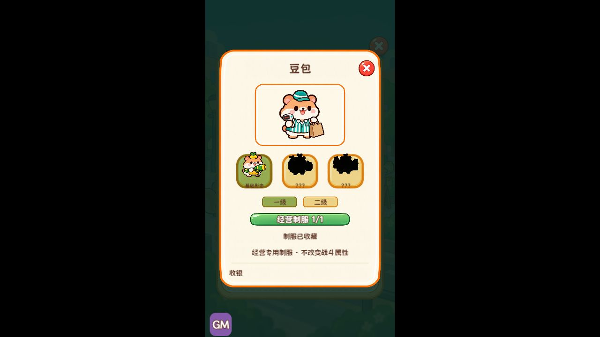

# 经营成长1.10.0 验证记录

日期：2026-10-12。本次实际工程 G:/DEMO001，开发分支 codex/pc-a/shop-growth；main未合并。

## 自动回归与模拟

- [完整回归输出](automated-checks.json)：配置31、资源12、挑战27、专题5、经营38、商店交互12、表现9、图鉴首页15，共149项。严格TypeScript、38张XLSX/CSV一致性和35个Prefab/2268节点检查通过。
- [实际游戏逻辑通关](playthrough-results.json)：执行实际GameRoot，20冒险、6挑战全部胜利；每挑战15波十次选择。隔离内存存档、无渲染自动策略，不等于真人或实体手机跑测。
- [数值模拟](economy-results.json)：10种子各2小时瓶颈对照；5种子每日上线2次、每次离线最多2小时、每天约推进1冒险关。设备雇佣与研发制服收藏均在第15天完成，末位店员受关卡条件限制。全部完成后余额继续积累，不把这一结果当留存结论。

## 浏览器实际操作

- 4347调试隔离存档：四架、上架九宫格、管理、研发和制服购买/切换、商品图鉴销量及已收藏制服展示；未修改用户4344存档作测试夹具。
- 4348正式隔离存档：正常进入首页及商店、管理五入口、商品选择、面包研发由Lv.0售价3升至Lv.1售价4，下一等级阶段限制生效；制服列表、挑战出战准备和首轮三选一正常。GM隐藏。
- 4344切换为新构建后：首页仍为冒险4/20；旧四架、已雇佣店员、设备和陈列保留，离线收益按规则到账。仅打开查看，未重置、充值或购买。
- 375×667、390×844、750×1334、1280×720真实截图分别检查，无按钮超出画面；临时视口已复位。[尺寸与校验清单](checks.json)。
- 最终版本运行错误均0；正式包与4344试玩warn/error均0。4347调试在切换测试视口时记录7条Cocos屏幕方向警告（Unexpected screen orientation: 13）；已修复的早期Floor路径报错不计入最终构建时段，原始历史留在临时目录。记录见对应console.json，调试统计起点为最终构建Finished时间。
- 真实浏览器达到的经营阶段为2/4架；6/8架、双收银、八员工并行和滚动上下界有业务及UI模型回归，不伪称已在浏览器经营到所有阶段。

## 构建边界

调试和正式Web Mobile日志分别在01:11:18、01:11:40显示Finished，构建产物已实际进入游戏。两个Creator进程退出码均为36，日志含编辑器window.json损坏、OTA_VERSION_CONFLICT及worker SIGTERM诊断；保留原始日志在G:/gptwork/shop-growth，本次未改动用户全局编辑器设置，不能表述为零诊断构建。未验证真机性能和平台真实广告。

## 关键截图

其余截图及机器可读报告同目录保存。
